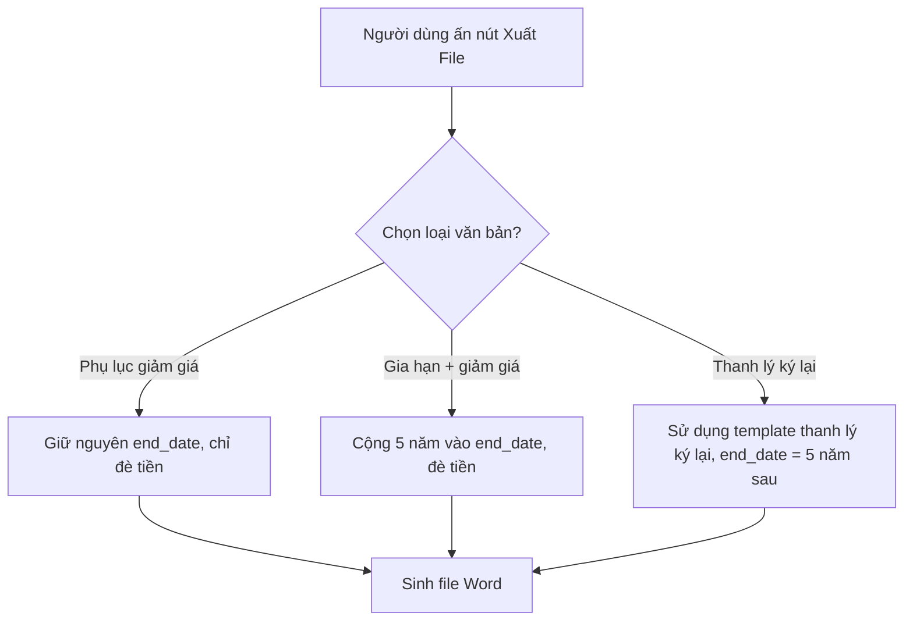

# SPEC: Hệ thống tự động xử lý đàm phán Hợp đồng nhà trạm sắp hết hạn

## 1. Executive Summary
Feature giúp tự động map templates Word chuẩn xác cho trạm hết hạn tuỳ số liệu đàm phán (Giảm giá vs Gia hạn vs Thanh lý ký lại) mà không phải gõ tay hoặc sinh rườm rà. MVP nhắm đến trạm sắp hết hạn (ví dụ DNCM38). 

## 2. User Stories
Là nhân viên quản lý trạm, khi tôi chọn tuỳ chọn thoả thuận trong bảng điều khiển, tôi muốn hệ thống xuất ra ngay văn bản Word có chứa nội dung ngày/tháng/tiền chuẩn xác để tôi đi xin chữ ký, tôi không phải sửa thời hạn tay.

## 3. Logic Flowchart

## 4. Tech Stack
- FastAPI Python Generator (python docx).
